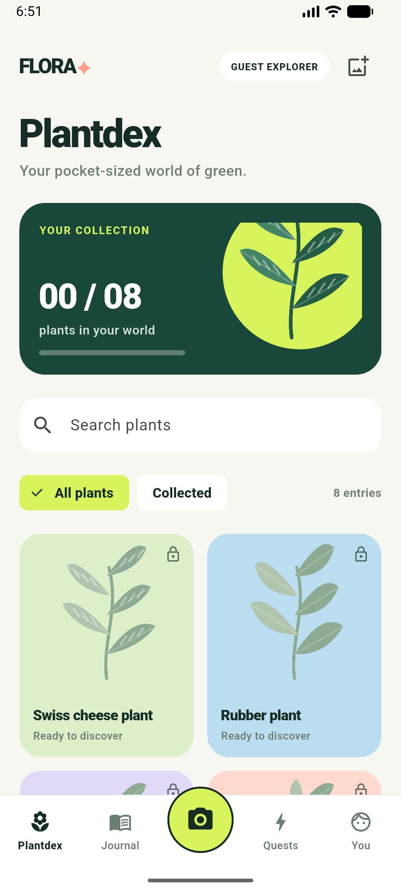
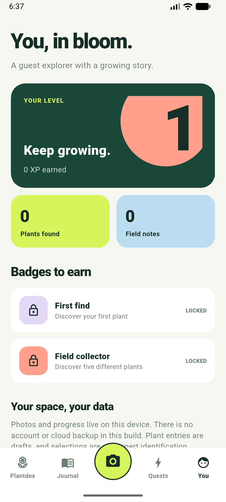

# FLORA

FLORA is an Android-first Flutter prototype for keeping a personal log of plants you notice. It runs in guest mode and stores observations and game progress locally on the device.

## Run locally

Install Flutter and the Android SDK, then run:

```sh
flutter pub get
flutter run
```

## What the app currently does

- Opens on the Plantdex and provides a center **Add a plant** camera action. The in-app FLORA Field Cam has a square viewfinder, five subtle digicam-inspired looks, a shutter, and a gallery picker. The square frame is only a preview; captures keep their full aspect ratio.
- Shows the selected photo for review. You can search the small sample catalog and manually choose a plant, or save the photo as unknown with an optional note. When a camera look is applied, review lets you save the edited copy or the original.
- Saves photos, notes, and observations in a local journal. You can edit notes and delete an observation.
- Tracks first discoveries, capped repeat XP, daily and weekly quest progress and claims, and two achievement milestones.
- Shows a searchable Plantdex with collected and undiscovered sample entries, plus profile stats and badges.
- Uses an adaptive Android launcher icon and a custom launch screen.

Plant selection is user-provided. FLORA does **not** identify plants from photos, recommend a match, or provide an identification confidence score. The sample catalog contains eight illustrative entries; it is not a reviewed or complete botanical reference. Treat selected names as personal labels, not verified identifications. Do not use FLORA to decide whether a plant is safe to eat, touch, or use as medicine.

## What is missing

- First-run onboarding and a guided first observation.
- In-app settings, display-name/avatar editing, accessibility preferences, data export, and a clear-all-data action.
- A larger, botanically reviewed catalog with distinct, rights-cleared images or artwork for every entry.
- Automatic photo identification, suggested matches, confidence values, and expert verification.
- Cloud backup, account sign-in, and transfer of local data to another device. Uninstalling the app or losing the device can remove its local photos and progress.
- Social features, notifications, and a more developed progression and reward system.

The UI has Plantdex, Journal, Quests, and profile tabs with a soft neutral palette, bright accents, original simple illustrations, and small entrance animations. Settings are not implemented yet.

Camera looks are creative effects inspired by the general feel of compact digital cameras. They are not official Canon or Sony modes. The live preview approximates the saved treatment; grain appears only after capture. Gallery photos are not filtered. Camera behavior and image processing still need testing on physical devices, especially lower-end phones.

## Screenshots







## Before release

Review the catalog and all plant safety language with qualified botanical sources, confirm imagery rights, add reliable backup and export controls, and test on physical Android devices with real photos. Any future identification feature needs a validated model and a clear way to communicate uncertainty.
