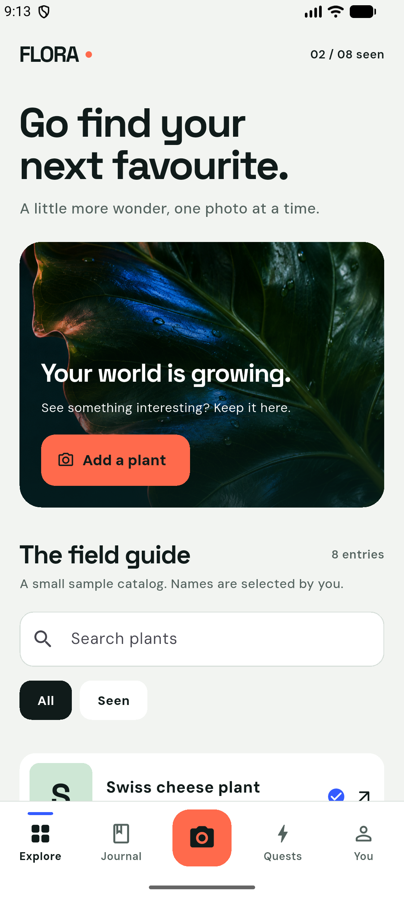
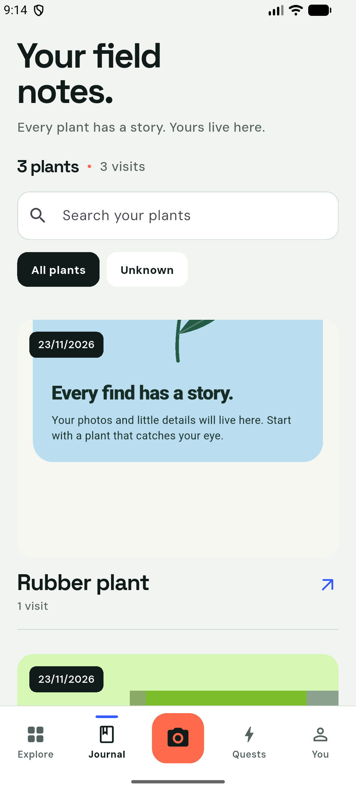
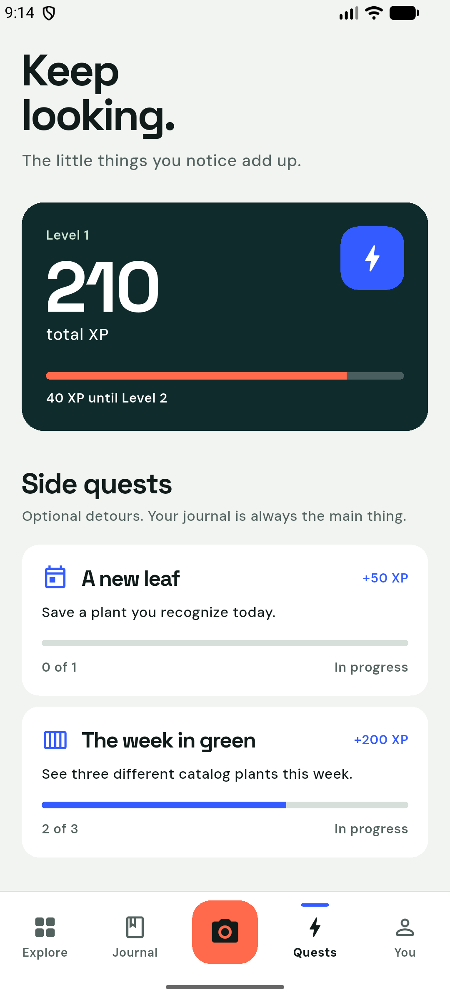
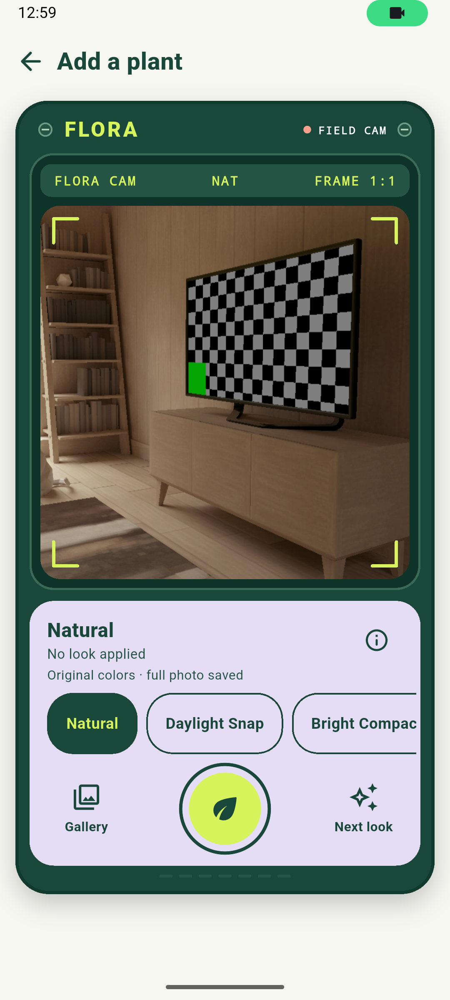

# FLORA

FLORA is an Android-first Flutter prototype for keeping a personal journal of plants you notice. It runs in guest mode and stores journal photos, notes, and game progress locally on the device. When the optional cloud suggestion service is configured, you can send a captured photo to Pl@ntNet for possible names.

## Run locally

Install Flutter and the Android SDK, then run:

```sh
flutter pub get
flutter run
```

The optional plant suggestion Worker is deployed at `https://flora-plant-suggestions.plant-suggestions.workers.dev`. To enable suggestions in a local run, use:

```sh
flutter run --dart-define=FLORA_IDENTIFY_ENDPOINT=https://flora-plant-suggestions.plant-suggestions.workers.dev
```

The Pl@ntNet key is stored as a Cloudflare Worker secret and is never included in the app. See [cloud/plant-suggestions/README.md](cloud/plant-suggestions/README.md) for deployment and limits. Builds without the endpoint still support manual naming and Unknown.

## What the app currently does

- Opens on **Explore**, a photo-led Plantdex, with a center **Add a plant** camera action. New observations require a photo taken in FLORA; gallery imports are unavailable. Field Cam has a square live viewfinder, front/rear switching, five subtle digicam-inspired looks, and a shutter. The square frame is only a preview; captures keep their full aspect ratio.
- Shows the selected photo for review. If the cloud service is configured, tapping **Find plant suggestions** sends the original capture to Pl@ntNet and shows ranked possible names with model scores. You must choose a suggestion; FLORA never silently labels a plant. You can also retake, search the small sample catalog, write your own unverified name, or save as Unknown. An optional nickname, place label, and field note make the entry personal. The place label is typed by the user; FLORA does not record GPS. When a camera look is applied, review lets you save the edited copy or the original. If saving fails or the photo is a duplicate, review stays open with a visible recovery message.
- On first run, explains camera capture, manual naming, and local storage, with a direct path to the first plant. A save confirmation shows the earned XP or saved count and can open the exact saved entry.
- Groups dated visits around each personal plant in a photo-led Journal. You can revisit the same plant with a new in-app camera photo, search names, places, and notes, filter unknown plants, edit its name/nickname/place, and review its timeline. Each visit can hold extra in-app photos, a note, and a zoomable photo view. You can edit a visit note or delete a visit; deleting the last visit also removes its plant page. Name corrections apply to all visits for that plant and update the Plantdex without awarding XP again. Earned XP remains after deleting a visit.
- Tracks first discoveries, capped repeat XP, daily and weekly quest progress and claims, and two achievement milestones.
- Shows a searchable Plantdex with collected and undiscovered sample entries. The guest profile has a local display name and icon, recent plants, stats, and badges.
- Exports a local FLORA backup file containing linked plants, visits, photos, notes, discoveries, and progress. The Profile or Settings screen can restore a backup after preview and explicit replacement confirmation. Older FLORA backups can also be restored. FLORA does not upload this file. Display name, icon, and accessibility preferences are not included in backups.
- Provides Settings for larger text, reduced motion, camera permission guidance, local privacy details, backup access, and a confirmed delete-all-local-data action.
- Uses an adaptive Android launcher icon and a custom launch screen.

Plant names are confirmed by the user. Pl@ntNet suggestions are model guesses, not verified identifications; their scores are useful for ranking, not proof. The sample catalog contains eight illustrative entries and is not a reviewed or complete botanical reference. Do not use FLORA to decide whether a plant is safe to eat, touch, or use as medicine.

## What is missing

- A deeper multi-step onboarding and a guided first observation walkthrough.
- Profile and accessibility settings in the backup format, plus a fuller first-plant walkthrough.
- A larger, botanically reviewed catalog with distinct, rights-cleared images or artwork for every entry.
- A deployed Pl@ntNet proxy is needed for live suggestions. There is no automatic naming, expert verification, or guarantee that a suggested species is correct.
- Cloud backup and account sign-in. Exporting and restoring a local backup file can transfer data, but unsaved local data may be lost on uninstall or device loss.
- Social features, notifications, and a more developed progression and reward system.

The Field Notes redesign uses photographic layouts, bundled Space Grotesk and DM Sans fonts, paper and midnight surfaces, signal blue and coral accents, and short optional `flutter_animate` transitions. Explore, Journal, Quests, profile, camera, review, and settings follow this visual system. The decorative leaf image on Explore was generated for FLORA and is not a plant identification reference. Settings is available from Profile.

Field Cam is built from Flutter widgets and painting around a live camera preview. Camera looks are creative effects inspired by the general feel of compact digital cameras. They are not official Canon or Sony modes. The live preview approximates the saved treatment; grain appears only after capture. Camera behavior and image processing still need testing on physical devices, especially lower-end phones.

## Screenshots

Captured on the Android emulator after the Field Notes redesign:







## Before release

Review the catalog and all plant safety language with qualified botanical sources, confirm imagery rights, test backup and restore with large real journals and on physical Android devices, and test the camera with real photos. Any future identification feature needs a validated model and a clear way to communicate uncertainty.
